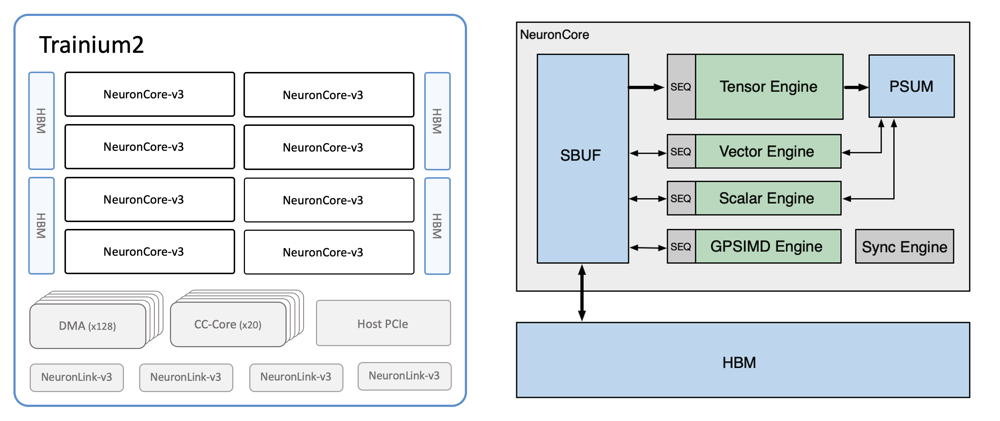
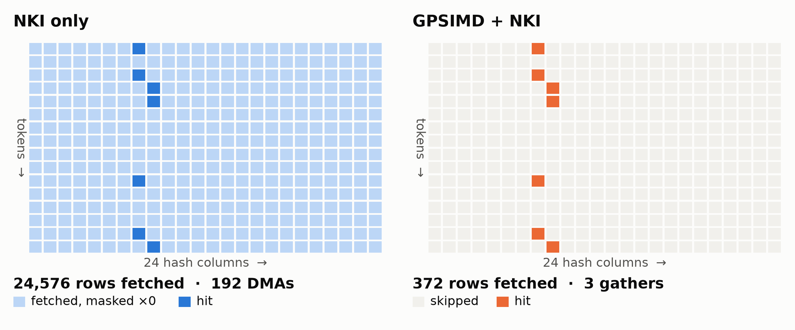

## Exploit the Native Hardware Heterogeneity: Custom GPSIMD Operator for Accelerating Emerging LLM Memory on AWS Trainium

> Disclaimer: Every Trainium conclusion and experiment in this blog comes from the Neuron SDK 2.33 toolchain, run and measured on a single trn3.48xlarge instance. We installed the Neuron GPSIMD Toolchain v1.25, which is a legacy version used for trn1 instances. We then built the toolchain by reverse engineering how the Neuron runtime loads and runs GPSIMD code, so treat all of the information as reference only. The information does not necessarily reflect how AWS implements things internally.

#### High-level Summary

- **Emerging LLM memory modules, such as Engram in DeepSeek-V4.1-Flash, have heterogeneous computation characteristics.** Engram finds a token's embedding memory with a 64-bit n-gram hash and a sparse table lookup, which are irregular bitwise integer operations and table lookups with irregular, non-consecutive data access. It then uses the memory with a dense GEMM for attention and a gate, which are dense regular computations. A GPU-FPGA prototype that moves the irregular steps to FPGAs and fuse with part of the attention, accelerating Engram by 5.9x on small batches, indicating that such disaggregation on heterogeneous platforms is promising.
- **Trainium's native heterogeneity allows a finer split than a GPU-FPGA system.** Each Trainium 3 NeuronCore pairs dense engines with a GPSIMD Engine, which is an 8-core SIMD processor. All engines share the on-chip SBUF with nanosecond level access latency and allows concurrent data access between engines, reducing the communication overhead. Unlike the FPGA in our prototype, which has abundant computational resources, the GPSIMD cores are slow at highly parallel arithmetic. We therefore deploy the n-gram hashing and table retrieval in Engram on GPSIMD and the rest on the other engines (Tensor, Vector, and Scalar Engines).
- **We can integrate GPSIMD custom operators into NKI kernels, even without public support.** NKI itself reaches the GPSIMD cores only through fixed built-in instructions, such as topk and iota. With our toolchain derived from the legacy GPSIMD toolchain for Trainium 1, the NKI kernel marks each call site with `gp.call`, and the toolchain compiles the C++ operator for the GPSIMD cores on Trainium 3. The toolchain then injects the operator into the compiled NEFF as one `KERNEL_CALL` instruction. The operator reads and writes the same SBUF tiles as the surrounding NKI code.
- **Two GPSIMD operators speed up Engram in DeepSeek-V4.1-Flash by up to 1.14x.** We compare against a hand-optimized NKI port of DeepSeek-V4.1-Flash. The n-gram hashing becomes 1.79x faster at decode, and the table retrieval becomes up to 4.9x faster. The whole Engram is 1.14x faster in prefill with 2048 tokens and 1.05x faster at decode.


*Figure 1. Speedup over the baseline without GPSIMD custom op (the hand-optimized NKI port), on one NeuronCore. Decode runs 10 sequences. Whole Engram counts both Engram layers.*

#### Table of Contents

- [1. Introduction](#1-introduction)
  - [1.1 Heterogeneity of Computation Properties in LLMs](#11-heterogeneity-of-computation-properties-in-llms)
  - [1.2 Example: Engram in DeepSeek-V4.1-Flash, and How We Accelerate It on a GPU-FPGA System](#12-example-engram-in-deepseek-v41-flash-and-how-we-accelerate-it-on-a-gpu-fpga-system)
  - [1.3 Native Hardware Heterogeneity of Trainium](#13-native-hardware-heterogeneity-of-trainium)
- [2. What Computation Should We Offload to the GPSIMD Engine?](#2-what-computation-should-we-offload-to-the-gpsimd-engine)
- [3. Build and Use GPSIMD Custom Operators with NKI](#3-build-and-use-gpsimd-custom-operators-with-nki)
  - [3.1 Overall Development and Deployment Flow](#31-overall-development-and-deployment-flow)
  - [3.2 Write Operators in C++](#32-write-operators-in-c)
  - [3.3 Integrate the Custom Operator with NKI](#33-integrate-the-custom-operator-with-nki)
  - [3.4 Runtime: What Happens Under the Hood](#34-runtime-what-happens-under-the-hood)
- [4. Accelerating Engram in DeepSeek-V4.1-Flash with the GPSIMD Engine](#4-accelerating-engram-in-deepseek-v41-flash-with-the-gpsimd-engine)
  - [4.1 n-gram Hashing](#41-n-gram-hashing)
  - [4.2 Table Retrieval](#42-table-retrieval)
  - [4.3 Other Optimization Considerations](#43-other-optimization-considerations)
  - [4.4 Results and Analysis](#44-results-and-analysis)
- [5. What Other Operations Can GPSIMD Help With?](#5-what-other-operations-can-gpsimd-help-with)
- [6. Limitations](#6-limitations)
- [7. Acknowledgement](#7-acknowledgement)

---

### 1. Introduction

#### 1.1 Heterogeneity of Computation Properties in LLMs

Modern LLMs depend on mechanisms that select and read a small part of a large memory: sparse attention selects key-value entries, retrieval-augmented generation (RAG) selects documents, and compressed memories select memory slots. Our study of these mechanisms [1] showed that all of the mechanisms share one **memory processing pipeline** of four steps (Figure 2):

1. **Prepare Memory**: turn the memory into a form that is easy to search and use (for example, indexing vectors).
2. **Compute Relevancy**: score or identify the memory entries that matter for the current input.
3. **Retrieval**: select and fetch the relevant subset.
4. **Apply to Inference**: feed the retrieved memory into the rest of the model.

The profiles in [1] showed that memory processing takes a large share of inference time (for example, 22% to 81% of decoding time for sparse attention at 1M tokens, and 40% to 61% for RAG over 20M documents). The steps also have very different computational characteristics. Prepare Memory and Apply to Inference are usually dense and regular. Compute Relevancy and Retrieval are often sparse, irregular, data-dependent and memory-bound, and GPUs leave much of their compute and memory bandwidth unused on such steps. [1] therefore **disaggregated** the pipeline over a GPU-FPGA heterogeneous inference system [2]: the dense steps stayed on the GPU and the irregular steps moved to the FPGA, for up to 2.2x faster inference and up to 4.7x lower energy. [1] also found that the cost of moving data over PCIe sometimes overrules the preferred placement of a step.


*Figure 2. The four-step memory processing pipeline in LLMs, from [1].*

#### 1.2 Example: Engram in DeepSeek-V4.1-Flash, and How We Accelerate It on a GPU-FPGA System

**Engram** [3] gives a language model a large, hashed n-gram memory. For every token, the model hashes the token together with the preceding tokens, looks up learned vectors for the resulting n-grams in a huge table, and adds a gated projection of the vectors to the hidden state. DeepSeek-V4.1-Flash has Engram in layers 1 and 14. The four steps of its memory processing pipeline are:

- **Prepare Memory.** The table is trained offline: 384M rows of 256 bf16 values, sharded by row over 64 ranks (6.0M rows, 3.1 GB per rank). At run time, NKI collects each token's n-gram window: the token's compressed id and the ids of the 3 preceding tokens.
- **Compute Relevancy.** An n-gram hash turns each window into row ids. For each n-gram size n = 2, 3, 4, every token id in the window is multiplied by a 64-bit constant for its position, the products are combined with XOR, and the result is reduced modulo one of 8 primes (all just above 16M), plus an offset per hash column. Each token gets 3 × 8 = 24 row ids per Engram layer. Unlike sparse attention, the relevancy is a deterministic address, not a score.
- **Retrieval.** Each rank gathers the rows that the rank holds into an embedding `emb` of shape [T, 24 × 256] and leaves the other rows zero; an all-reduce over the 64 ranks completes `emb`.
- **Apply to Inference.** An fp8 MX GEMM projects `emb` from 6144 to 25600 values (5 × 5120: 4 keys and 1 value), and a gate adds the value to each of the 4 residual streams, scaled by a normalized dot product of the stream's hidden state and its key.

The steps have different computational characteristics. Compute Relevancy is 64-bit integer arithmetic, and Retrieval is a data-dependent lookup with irregular, non-consecutive memory accesses. Apply to Inference is dense floating-point work: a GEMM and a gate.

We applied the disaggregation of [1] to Engram on a GPU-FPGA system. The GPU-FPGA implementation is part of HeteroLLM [2]. The experiment uses the reference configuration that DeepSeek released with the Engram paper [4], not the configuration of DeepSeek-V4.1-Flash that the rest of this blog uses, so the times in this section do not compare directly with the Trainium times later in the blog:

| | Engram reference configuration [4] (GPU-FPGA experiment) | DeepSeek-V4.1-Flash [5] (Trainium experiments) |
|---|---|---|
| Hidden size × residual streams | 1024 × 4 | 5120 × 4 |
| n-gram sizes × hash heads | {2, 3} × 8 = 16 lookups per token | {2, 3, 4} × 8 = 24 lookups per token |
| Table rows per hash head | about 646K | about 16M |
| Values per table row | 64 | 256 |
| Memory vector `e` per token | 1024 values | 6144 values |
| Key and value projection | 1024 -> 5 × 1024 (4 keys, 1 value) | 6144 -> 5 × 5120 (4 keys, 1 value) |

**Setup.** The GPU is an AMD Instinct MI210, and the FPGA is an AMD Alveo U55C board with 16 GB of HBM. The FPGA kernel is written in TAPA (C++ high-level synthesis) and computes with 16-bit fixed-point tables and weights. The GPU-only baseline is the reference PyTorch implementation of Engram [4]: the reference code computes the hash on the host CPU with numpy, copies the ids to the GPU, and runs the other stages as PyTorch operators in fp32.

The Engram module of one layer has five stages. Figure 3 shows how we split the stages between the FPGA and the GPU:

- **FPGA**: the multiply-XOR hash of each n-gram (Compute Relevancy), the load of the 16 embedding rows of each token from the hashed tables (Retrieval), and the key and value projections of the loaded embeddings. The hash unit takes one token per cycle and computes all 16 table ids in parallel. 16 lookup units, one per hash head, read the rows from separate HBM channels. 8 projection units keep the 5120 × 1024 weight matrix in on-chip memory (URAM), each unit with 128 of the 1024 columns, and add their partial results in a chain.
- **GPU**: three HIP kernels. The gate normalizes the key and the hidden state of each branch, computes a scaled dot product, and scales the value by a sigmoid of the dot product. The short convolution normalizes the gated value and applies a depthwise causal convolution (kernel 4, dilation 3) and SiLU. The last kernel adds the residual.

The cut follows the data dependencies. The hash, the load and the projections depend only on the token ids, so the FPGA computes these stages without the hidden state. The gate and the convolution need the hidden state, which the GPU produces in the previous layer. The FPGA writes the keys and the value of every token (5 × 1024 fp32 values, 20 KB) into a buffer in its HBM that the GPU can read over PCIe.


*Figure 3. The GPU-FPGA split of the Engram module in HeteroLLM [2]. The FPGA runs the steps that depend only on the token ids; the GPU runs the steps that need the hidden state h. Engram reference configuration [4] (hidden size 1024), not DeepSeek-V4.1-Flash.*

On the GPU alone, at 1024 tokens, the module takes 6.46 ms: 1.26 ms for the hash, 0.38 ms for the load, 3.85 ms for the projections and the gate together, and 0.87 ms for the convolution. The table below lists all measurements. The GPU-FPGA time is the FPGA kernel time plus the GPU kernel time, without overlap between the two devices and without the transfer of the keys and the value. The two-board time is an estimate: the FPGA time is divided by two, as if each board processes half of the tokens.

| Tokens | Engram, GPU only (reference code) | Engram, GPU + FPGA: FPGA part (1 board) | GPU part | Engram, GPU + 2 FPGA boards (estimate) | Speedup with 2 boards |
|---:|---:|---:|---:|---:|---:|
| 8 | 3.86 ms | 0.39 ms | 0.55 ms | 0.74 ms | **5.2x** |
| 32 | 5.68 ms | 0.59 ms | 0.66 ms | 0.96 ms | **5.9x** |
| 1,024 | 6.46 ms | 9.51 ms | 0.86 ms | 5.61 ms | 1.15x |
| 8,192 | 9.68 ms | 73.3 ms | 1.61 ms | 38.3 ms | 0.25x |
| 32,768 | 34.4 ms | 295.2 ms | 2.98 ms | 150.6 ms | 0.23x |


*Figure 4. The Engram module on the GPU alone (reference PyTorch code) and on the GPU with 2 FPGA boards (estimated as the FPGA time divided by 2, plus the GPU time). Engram reference configuration [4], not DeepSeek-V4.1-Flash.*

Figure 4 shows two regimes:

- **Few tokens: the split wins.** For 8 and 32 tokens, the GPU-only version takes 3.86 ms and 5.68 ms. The GPU-only time hardly depends on the number of tokens: 128 times more tokens (8 to 1024) take only 1.7 times longer. Most of the GPU-only time is therefore a fixed cost per call, such as the hash on the host, the copy of the ids and the launch of many small operators, not work per token. In the GPU-only version, the hash alone takes 0.98 ms for 8 tokens, 2.5 times the 0.39 ms that the FPGA needs for the hash, the load and the projections together. With two boards, the module becomes 5.2x faster for 8 tokens and 5.9x faster for 32 tokens. A decode step processes few tokens, so decode falls in this regime. Part of the gain comes from the implementation and not only from the hardware: the baseline is the unoptimized reference code, while the GPU side of the split uses fused HIP kernels.
- **Many tokens: the split loses.** From 1024 tokens on, the FPGA time grows in proportion to the number of tokens (about 9 µs per token), while the GPU-only time grows slowly (from 6.46 ms at 1024 tokens to 34.4 ms at 32768 tokens). The hash and the load take little time per token on the FPGA, but the projections multiply each memory vector by the 5120 × 1024 weight matrix: 5.2M multiply-accumulates per token, or about 0.6 trillion multiply-accumulates per second at 9 µs per token. The GPU runs the same dense projection much faster. At 8192 and 32768 tokens, the GPU-FPGA version is 4.0x and 4.4x slower than the GPU alone, even with two boards and without counting the transfers. Four boards would still be 2.1x and 2.2x slower (estimated the same way).

The experiment gives three lessons for a disaggregated design:

1. **Irregular steps gain the most from flexible hardware, especially at small sizes.** The hash and the table load are integer and memory steps; the GPU reference code does not even run the hash on the GPU.
2. **Dense steps must stay on dense hardware at every size.** The projections on the FPGA limit the split at long sequences.
3. **The hand-off between the devices limits where the cut can go.** As [1] also found, every cut between a GPU and an FPGA adds a PCIe transfer and a synchronization.

#### 1.3 Native Hardware Heterogeneity of Trainium

**AWS Trainium** is a family of AI accelerators designed by Annapurna Labs. A trn3.48xlarge instance exposes 64 logical NeuronCores (each made of 2 physical NeuronCores). Like Trainium 2, a Trainium 3 NeuronCore is a heterogeneous processor (Figure 5). The **Tensor Engine** is a 128x128 systolic array for matrix multiplication. The **Vector Engine** and the **Scalar Engine** apply element-wise operations, reductions and activation functions to tiles of up to 128 partitions. The **Sync Engine** issues queued DMA transfers. All engines read and write the on-chip **SBUF**, and the Tensor Engine accumulates into **PSUM**.

The fifth engine, the **GPSIMD Engine** (named "Pool" in the NEFF), is different from the other four. The GPSIMD Engine is a group of 8 general-purpose cores (Cadence Xtensa, 32-bit, 1.2 GHz). Each core has its own local data RAM, an integrated DMA channel (iDMA), and an integer instruction set with a full 32 x 32 -> 64-bit multiply (`MULL` for the low word, `MULUH` for the high word). The cores run firmware that implements the GPSIMD Engine's instructions in software.


*Figure 5. Trainium 2 device diagram and the architecture of a NeuronCore, from the Neuron SDK documentation [6]. A Trainium 3 NeuronCore has the same five engines.*

The **Neuron Kernel Interface (NKI)** is the Python kernel language for Trainium [6]. NKI exposes the GPSIMD Engine only through built-in instructions: tensor operations with `engine=gpsimd`, `iota`, and the descriptor generation of indirect DMAs ("software DGE"). Every built-in instruction is a whole-tile operation with a fixed meaning, executed by the firmware on all 8 cores. NKI has no way to run new code on the cores. Trainium 1 had a C++ custom-operator path (`AwsNeuronCustomOp`), but the compiler rejects that path for Trainium 2 and Trainium 3 targets (error `NCC_EVRF030`).

A Trainium 3 NeuronCore already contains both kinds of hardware. The Tensor, Vector and Scalar Engines are wide and fast for regular work, and the GPSIMD cores are flexible for irregular integer work. Both sides read and write the same SBUF, so moving a step from one side to the other costs one semaphore hand-off of a few microseconds instead of a PCIe transfer. A cheap hand-off allows a finer cut than the GPU-FPGA split: on Trainium 3, only the hash and one compaction step go to the GPSIMD cores, while the table gathers, the projections and the gate stay on the NKI engines (Section 4).

The missing piece was a way to run custom code on the GPSIMD cores. Section 2 discusses which computations should move to the cores. Section 3 describes our toolchain, which compiles C++ operators for the cores and places the operators inside NKI kernels. Section 4 applies the toolchain to the Engram module of DeepSeek-V4.1-Flash, against the hand-optimized NKI code of a DeepSeek-V4.1-Flash port for Trainium 3 [5].

---

### 2. What Computation Should We Offload to the GPSIMD Engine?

Each engine of a NeuronCore fits a different kind of computation:

| Computation | Best engine | Programmed with |
|---|---|---|
| Matrix multiplication, dense projections | Tensor Engine | NKI (`nisa.nc_matmul`) |
| Element-wise math, reductions, activations, floating point | Vector / Scalar Engines | NKI |
| Data movement with static addresses | DMA queues, Sync Engine | NKI (`nisa.dma_copy`) |
| Data movement with run-time addresses | GPSIMD Engine (descriptor generation) | NKI (indirect `dma_copy`) |
| 64-bit integer math, per-element branches, compaction, scans, variable-length output | GPSIMD cores | **this work: C++ custom operators** |

Hashing, filtering and compaction appear in many memory-processing steps of LLM inference, and NKI expresses these steps only with many whole-tile instructions or with masks that compute every element anyway.

NKI programs every engine with whole-tile instructions and static shapes. The table below compares how NKI and a GPSIMD operator express the irregular operations of memory processing:

| Operation | NKI (Tensor, Vector, Scalar Engines and GPSIMD built-ins) | GPSIMD custom operator |
|---|---|---|
| 64-bit integer multiply and modulo | int32 tile operations only; 64-bit products are built from lookup tables and chunks | `MULL` + `MULUH` give the full 64-bit product in two instructions |
| Different control flow per element | one instruction for the whole tile; masks compute both branches for every element | ordinary branches per element |
| Variable-length output (compaction) | static shapes; `nonzero_with_count` compacts within each partition row only | a running counter and arbitrary output positions |
| Skipping work for invalid indices | an out-of-bounds entry of an indirect DMA is skipped, but its descriptor still costs about 5.5 ns | invalid entries never reach a DMA |
| Loops with a run-time trip count | `nl.fori_loop`: about 2.4 µs per iteration, because every engine drains at each block boundary | a loop inside the operator costs a few cycles per iteration |
| Dense matmul, floating point | native and fast | software float: 100 to 300 cycles per operation |

The last row is the reason to split the work rather than move a whole module to GPSIMD: each side does what the other side does badly.

The cost of a GPSIMD operator decides how small a step can be. The table below lists the measured costs (with `toolchain/probes/bench` and the case studies; 1 cycle = 0.83 ns):

| Item | Cost |
|---|---|
| `KERNEL_CALL` overhead (call, dispatch, return) | about 2.6 µs |
| local RAM load / store | 12 / 7 cycles |
| SBUF load / store through the window | about 296 / 19 cycles |
| iDMA copy SBUF -> local RAM | about 600 cycles for 4 KB; 128 cycles per KB for 16 KB |
| 32-bit integer multiply / divide | 3 / 20 cycles |
| software float32 add / multiply | 117 / 97 cycles |
| barrier over the 8 cores | about 4,600 cycles |

The GPSIMD cores are fast at integer work in local RAM, slow at floating point, and need about 2.6 µs per call. A step is therefore a good candidate for a GPSIMD operator when the step is integer-heavy, data-dependent, and small in data compared with the dense work around the step. Dense floating-point work stays on the other engines.

---

### 3. Build and Use GPSIMD Custom Operators with NKI

#### 3.1 Overall Development and Deployment Flow

The Neuron compiler turns an NKI kernel into a NEFF, a binary with one instruction stream per engine. Our toolchain does not change the compiler. Instead, it edits the compiled NEFF, using the NEFF format documented in [7], to place each custom operator in the GPSIMD Engine's instruction stream. Figure 6 shows the flow:

1. **Write** the operator in C++ (Section 3.2).
2. **Mark** the call site in the NKI kernel with `gp.call(...)`, and compile the kernel with the NKI compiler as usual (Section 3.3).
3. **Build** the operator library: the toolchain reads each tile's SBUF location from the compiled NEFF and compiles the C++ operator for the GPSIMD cores (Section 3.3).
4. **Inject** the library into the NEFF and replace the marked instructions with one `KERNEL_CALL` (Section 3.3).
5. **Load and run** the NEFF with the Neuron runtime (Section 3.4).

`gpsimd-build` runs all steps for an example directory, and `gp.compile` runs them from Python.


*Figure 6. Development and deployment flow; the numbers are the steps listed above. Blue: NKI kernel and NEFF. Orange: the GPSIMD operator. The compiled NEFF is edited, not regenerated.*

#### 3.2 Write Operators in C++

An operator is a C++ function that runs on all 8 cores at the same time. The runtime library gives each core typed views of the call's SBUF tiles, a share of the work, and asynchronous iDMA copies between SBUF, HBM and the core's local RAM:

```cpp
#include <gpsimd/gpsimd.hpp>
GPSIMD_OP(vadd_i32) {                         // extern "C" void vadd_i32(gp_call *), runs on all 8 cores
    gp::Call c(call);
    auto a = c.in<int32_t>(0), b = c.in<int32_t>(1);      // SBUF tiles passed by gp.call
    auto o = c.out<int32_t>(0);
    const uint32_t n = o.elems();
    int32_t la[4096], lb[4096];                           // staging buffers in local data RAM
    for (gp::Range blk : c.blocks(o.partitions(), 4096 / n)) {   // this core's partitions
        c.fetch(a, blk.lo, blk.size(), la);                       // iDMA SBUF -> local RAM
        c.dma_wait(c.fetch(b, blk.lo, blk.size(), lb));
        for (uint32_t k = 0; k < blk.size() * n; ++k) la[k] += lb[k];
        c.dma_wait(c.flush(o, blk.lo, blk.size(), la));           // iDMA local RAM -> SBUF
    }
}
```

The runtime also provides a barrier, all-reduce, exclusive scan, a software lock for cross-core cooperation, IEEE float32 in software (`gp::f32`, bit-identical to numpy), and math functions. The compiler wrapper rejects code that the Trainium 3 cores cannot run: hardware floating point, vector (FLIX) instructions, and exclusive-access atomics all hang on these cores.

#### 3.3 Integrate the Custom Operator with NKI

**Mark the call site.** The NKI side passes SBUF tiles to `gp.call`:

```python
import gpsimd_nki as gp

@nki.jit
def kernel(a, b):
    out = nl.ndarray((128, 512), dtype=nl.int32, buffer=nl.shared_hbm)
    ta, tb, tc = (nl.ndarray((128, 512), dtype=nl.int32, buffer=nl.sbuf) for _ in range(3))
    nisa.dma_copy(dst=ta, src=a); nisa.dma_copy(dst=tb, src=b)
    gp.call("vadd_i32", ins=[ta, tb], outs=[tc])        # runs on the 8 GPSIMD cores
    nisa.dma_copy(dst=out, src=tc)
    return out
```

The NKI compiler knows nothing about custom operators, so `gp.call` emits **marker instructions**: ordinary GPSIMD Engine instructions (`TENSOR_SCALAR_ARITH_OP`, `MEMSET`) whose immediate operand carries a tag (`2^20 + 4096·site + 512·role + 32·argument + chunk`). The markers make the compiler do three things that the real operator needs:

- **Keep and place the tiles.** A *touch* marker updates each input tile in place, and a *join* marker fully writes each output tile. The compiler allocates SBUF for every tile and keeps the tiles alive across the call. The markers touch whole tiles, because the compiler tracks dependencies per element range and deletes the producers of any tile region that nobody reads.
- **Order the call.** The markers are chained through a small token tile, so every producer of an input runs before the call and every consumer of an output runs after the call.
- **Reserve scratch.** A *fill* marker reserves an SBUF scratch tile for cross-core cooperation.

**Build the operator library.** `gpsimd-neff analyze` reads the compiled `kernel.neff`, finds the tagged markers in the GPSIMD Engine's instruction stream (`Pool0.bin`), and reads every tile's SBUF location from the marker operands: the first partition, the number of partitions, the byte offset inside a partition, the data type, and the free-axis access pattern. The result is `sites_resolved.json`.

`gpsimd-cc` then compiles the operator with the Xtensa compiler shipped in the Neuron SDK (`xt-clang`, base instruction set only) and links the operator into `ops.so`:

- **A call-site table**, generated from `sites_resolved.json`, with the tile locations of every call site. We did not find a way for the operator to read the `KERNEL_CALL` operands at run time, so the tile addresses are compiled into the library. Each call site gets its own entry function `<operator>__s<site>`.
- **The runtime** (`rt.c`): dispatch on all 8 cores, the iDMA driver, barrier and reductions, a log ring, and a per-core receipt.
- **The layout the firmware expects**: code at `0x01000000`, data at `0x02000000`, a GNU build-id, and one ELF note (owner `Neuron`, type 2) per entry function. Code must fit in 64 KB and static data in about 7 KB; large buffers live on the stack (up to 64 KB in our examples).

**Inject the operator into the NEFF.** `gpsimd-neff inject` edits the NEFF in place of the compiler. A NEFF is a 1024-byte header plus a tar archive with one instruction stream per engine [7]. Injection adds two files and one key to the archive:

```text
final.neff
└── sg00/
    ├── Pool0.json               + "gpsimd_kernels_def": "gpsimd_kernels_def.json"
    ├── gpsimd_kernels_def.json  + [{"name": "ngram_hash__s0", "lib": "/sg00/ops.so"}]
    ├── ops.so                   + the operator library (Xtensa ELF)
    └── Pool0.bin                   markers replaced by one KERNEL_CALL per call site
```

In `Pool0.bin`, each call site's markers become one `KERNEL_CALL` (opcode `0x85`) at the position of the site's first output marker. Byte 12 of the `KERNEL_CALL` is the index of the operator in `gpsimd_kernels_def.json`. The other markers become `EVENT_SEMAPHORE` instructions that keep the markers' waits, and the fill marker becomes a real `MEMSET` that clears the scratch tile. The bytes below come from the n-gram hashing kernel of the case study:

```text
// Pool0.bin of kernel.neff (before), bytes 0-11
slot 67:  43 10 00 00 05 03 13 03 1c 00 00 00   TENSOR_SCALAR_ARITH_OP  wait S[3] >= 28; then S[3] += 1   (join marker)
slot 68:  d4 10 00 00 05 03 00 00 1d 00 00 00   PSEUDO_DMA_DIRECT2D     wait S[3] >= 29                    (reads the output)

// Pool0.bin of final.neff (after)
slot 68:  85 10 00 00 00 00 15 03 09 00 00 00   KERNEL_CALL             operator 0; then S[3] += 9 (SEM_ADD_IMM_COMPLETE)
slot 69:  d4 10 00 00 05 03 00 00 1e 00 00 00   PSEUDO_DMA_DIRECT2D     wait S[3] >= 30
```

The GPSIMD Engine's instructions report completion on semaphore S[3], and every consumer waits for a count on S[3]. The 9 markers of this call site each added 1 to S[3], so the `KERNEL_CALL` adds 9 when the operator finishes, and every count the program waits for stays reachable. The new `MEMSET` adds one more increment, so the injector raises every later wait on S[3], in all five engine programs, by one (29 becomes 30). Before injection, a wait for any later GPSIMD Engine instruction also implied that the markers had finished. After the renumbering, every wait on S[3] still covers the same instruction as before and also covers the `KERNEL_CALL` of every earlier call site.

The injector also handles NKI's dynamic control flow (`nl.fori_loop` with a trip count loaded into a register at run time), which the Engram retrieval needs. The compiler splits such programs into blocks, and at each block boundary every engine drains, synchronizes and resets its semaphores (`EVENT_SEMAPHORE_RANGE_CLEAR`, opcode `0xB0`). The injector therefore renumbers waits only up to each engine's first reset, requires every `gp.call` to come before the first dynamic loop, and relocates the absolute instruction index of the `0xDD` jump instruction after inserting slots.

#### 3.4 Runtime: What Happens Under the Hood

The Neuron runtime reads `gpsimd_kernels_def` when the runtime loads the NEFF, and the firmware copies `ops.so` from HBM into the local RAM of all 8 cores with the iDMA. At each `KERNEL_CALL`, the firmware calls the operator's entry function on all 8 cores, with the core index as an argument.

The cores reach SBUF and HBM through address-translation windows. Our runner, `gpsimd-run` (a C++ program on libnrt), programs one window over PCIe BAR0 after the NEFF is loaded: SBUF partition `p` appears at core address `0xD0000000 + p × 0x40000`. Further windows map HBM tensors from `0xE0000000` (512 MB). During a call, the runtime borrows the iDMA channel from the firmware and restores the channel's descriptor pointer exactly at the end of the call; otherwise, the firmware fails when the model stops.

After every execution, each core writes a receipt: its processor id, the number of calls, the call sites the core ran, its cycle count and its status. The receipts prove that the operator ran on the 8 GPSIMD cores and not on the host. `gpsimd-run` also compares every output with a reference, byte for byte. The toolchain has 19 examples, all bit-exact on the device, that cover integer and float data types, cross-core cooperation, SBUF views, direct HBM access and several call sites per kernel; a separate test covers dynamic control flow.

---

### 4. Accelerating Engram in DeepSeek-V4.1-Flash with the GPSIMD Engine

Section 1.2 introduced Engram and its four steps. Figure 7 shows our split between the GPSIMD cores and NKI on one NeuronCore:


*Figure 7. The Engram computation of one layer in the four-step memory processing pipeline of [1], split between GPSIMD custom operators and NKI.*

Compared with the GPU-FPGA split of Figure 3, the cut is finer: the GPSIMD cores take only the integer steps (the hash and a hit compaction). The gathers, the gate and the projection GEMM, which limited the FPGA at long sequences, stay on the NKI engines.

**Baseline and setup.** The baseline is the hand-optimized NKI code of the DeepSeek-V4.1-Flash port in [5] (branch `deepseek_v41_trn3`, commit `3b74533`). Each experiment copies the port's NKI helper modules without changes, runs the whole Engram computation on one NeuronCore, and changes only the part named in each section. The table shard has the deployed size (6,000,097 rows, 3.1 GB) with random values, and the row ids follow the hash distribution of the model. The collectives are not run. Latency is the median `total_exec_time` of 5 profiled executions in Neuron Explorer [6]. Every output of the GPSIMD version is checked against a numpy reference and against the NKI version: the n-gram ids equal an exact Python-integer reference, `emb` is exact, and the read-out output is bit-identical to the output of the port.

#### 4.1 n-gram Hashing

The port computes the n-gram ids of both Engram layers (48 ids per token) once per decode step, in its step prologue. A decode step of 10 sequences verifies 1 + 5 drafted tokens per sequence, so the hash runs on T = 60 rows.

NKI engines compute exact integer arithmetic only on 32-bit values and only in limited forms, but the hash needs 64-bit products and a 64-bit modulo. The port therefore reads each product (token id × multiplier, as two 32-bit words) from a precomputed [99092, 16] table with an indirect DMA, combines the words with XOR, and reduces the 63-bit result with Horner's rule over 7-bit chunks, each step with an fp32 quotient estimate corrected by one prime. In the profile, the arithmetic part of the NKI hash is 230 instructions: 166 on the Vector Engine, 58 GPSIMD built-in instructions and 6 DMAs, mostly in one long dependent chain.

The GPSIMD version keeps the window gathers of the port in NKI and replaces the arithmetic part with one operator, `ngram_hash`. Each core hashes its share of the rows in registers:

```cpp
// (token id x multiplier) mod 2^64 as two words: MULUH and MULL, then XOR into the rolling value
rh ^= mulhi(cid, ml) + cid * mh;
rl ^= cid * ml;
// v = rh * 2^32 + rl (v < 2^63) mod p, with mu = floor(2^64 / p) from the host:
// Barrett reduction, the quotient estimate is at most 3 too small
const uint64_t mid = (uint64_t)lo * muh + (uint64_t)hi * mul + mulhi(lo, mul);
const uint32_t q = hi * muh + (uint32_t)(mid >> 32);
uint32_t r = lo - q * p;
if (r >= p) r -= p;
if (r >= p) r -= p;
if (r >= p) r -= p;
```

#### 4.2 Table Retrieval

Each hash column j covers its own range of about 16M global rows, and rank r holds 6.0M consecutive rows. A rank's shard therefore overlaps at most 2 of the 24 columns of a layer, and only about 0.375 of a token's 24 lookups (1.5%) hit the rank. In our prefill chunk of T = 1024 tokens, rank 21 holds 372 of the 24,576 rows.


*Figure 8. The ids of 16 tokens of one Engram layer on rank 21; only hash columns 7 and 8 overlap the rank's rows. Left: the NKI port fetches every row and masks the misses. Right: a GPSIMD operator lists the hits, and NKI fetches only those rows. The totals below the grids are for T = 1024.*

The port's `engram_gather` cannot know in advance which ids hit, because NKI needs static shapes. The port therefore computes a mask for every id, issues one indirect DMA of 128 rows per 128-token tile and hash column (192 DMAs at T = 1024), and multiplies the result by the mask. Every index of an indirect DMA costs about 5.5 ns of descriptor generation on the GPSIMD Engine, even when the index is marked out of bounds and skipped: in a separate test, 64 gathers of 640 rows took 224 µs whether 100%, 25% or 0% of the indices were valid. The 98.5% of indices that miss therefore cost as much as the hits.

The GPSIMD version replaces the gather loop with one operator, `engram_hits`, and one short NKI loop:

```cpp
// GPSIMD: each core scans its 16 partitions (all tiles, all 24 columns) after one iDMA fetch
for (uint32_t i = 0; i < NT; ++i)
    for (uint32_t j = 0; j < NCOL; ++j) {
        const uint32_t v = (uint32_t)r[i * NCOL + j];       // shard-local row id
        if (v < ROWW) { src[n] = v; dst[n] = (i * 128u + p) * NCOL + j; ++n; }
    }
const uint32_t off = c.exscan_add(n, &total);               // place each core's list
// one iDMA per list; core 0 pads to a multiple of 128 and writes the number of 128-hit chunks
```

```python
# NKI: zero-fill emb, then one gather and one scatter of 128 rows per chunk of hits
gp.call("engram_hits", ins=[ids_sb], outs=[hits_sb, cnt_sb])
reg = nisa.register_alloc(); nisa.register_load(reg, cnt_sb)
nl.fori_loop(0, reg, chunk, step=1)     # chunk(b): load 128 (table row, emb row) pairs, gather, scatter
```

NKI alone cannot do this compaction efficiently. `nonzero_with_count` compacts within one partition row, so the ids would first need a different layout, and the compacted indices would need a second indirect gather. Skipped indices cost as much as valid ones, and a run-time loop costs 2.4 µs per iteration.

#### 4.3 Other Optimization Considerations

**Tune the operator for the GPSIMD cores.** The n-gram hashing operator went through three versions. The first version processed one row at a time and reduced each value with Horner's rule over 8-bit chunks, one 32-bit Barrett step per chunk (5 steps per value); at 93.8 µs, the first version was slower than NKI (0.93x). Processing column by column keeps each prime's constants in registers, and skipping the padding rows of the 128-row tile brought the time to 62.2 µs. The final 64-bit Barrett reduction above needs 6 multiplies and at most 3 corrections per value, for 48.45 µs (1.79x).

**Decode needs a static schedule.** At decode (T = 60), the run-time loop hurts more than the loop saves. At every block boundary of `nl.fori_loop`, every engine drains and synchronizes, which stopped the weight stream of the following GEMM from overlapping with the gather: with the loop, the whole read-out was 0.98x the NKI version. A token has at most 2 hits, so a second operator, `engram_hits_t`, writes the hits directly in the layout of a fixed number of indirect DMAs (2 gathers and 2 scatters per 128-token tile), with the unused entries marked out of bounds. With the static schedule, the retrieval stage takes 24.7 µs instead of 62.1 µs (2.51x), and the read-out keeps its overlap.

**Keep dense work and data movement in NKI.** The fp8 GEMM and the gate are dense floating-point work, so the two operators leave them in the port's NKI code. The window gathers of the hashing and the row gathers of the retrieval also stay in NKI as indirect DMAs; the operators only compute the ids and the list of hits.

#### 4.4 Results and Analysis

The table below lists all results. The read-out is one Engram layer: table retrieval, fp8 GEMM and gate. Whole Engram is the n-gram hashing (one call computes the ids of both Engram layers) plus the read-out of both layers, as in Figure 1.

| Engram computation | Size | NKI | GPSIMD + NKI | Speedup | GPSIMD does | NKI does |
|---|---|---:|---:|---:|---|---|
| n-gram hashing | decode, 10 sequences (T = 60) | 86.95 µs | 48.45 µs | **1.79x** | 64-bit products, XOR, modulo | n-gram window gathers |
| | prefill chunk, T = 1024 | 531.1 µs | 449.7 µs | 1.18x | | |
| | prefill chunk, T = 2048 | 1055.6 µs | 890.6 µs | 1.19x | | |
| retrieval stage | decode (T = 60) | 62.1 µs | 24.7 µs | **2.51x** | hit compaction | zero-fill, gather and scatter of hits |
| | prefill chunk, T = 1024 | 506.9 µs | 102.4 µs | **4.95x** | | |
| | prefill chunk, T = 2048 | 980.5 µs | 200.7 µs | **4.89x** | | |
| whole read-out | decode (T = 60) | 697.1 µs | 681.0 µs | 1.02x | hit compaction | retrieval DMAs, fp8 GEMM, gate |
| | prefill chunk, T = 1024 | 3362.9 µs | 2968.9 µs | **1.13x** | | |
| | prefill chunk, T = 2048 | 6766.4 µs | 5926.4 µs | **1.14x** | | |
| whole Engram (hashing + 2 × read-out) | decode (T = 60) | 1481.2 µs | 1410.5 µs | **1.05x** | hashing, hit compaction | window gathers, retrieval DMAs, fp8 GEMM, gate |
| | prefill chunk, T = 1024 | 7256.9 µs | 6387.5 µs | **1.14x** | | |
| | prefill chunk, T = 2048 | 14588.4 µs | 12743.4 µs | **1.14x** | | |

**n-gram hashing.** Figure 9 shows where the time goes. Both versions spend the first 34 µs on the same NKI window gathers. After the gathers, the NKI version runs a long chain of small instructions on the Vector Engine and the GPSIMD built-ins for 62 µs, while the GPSIMD version runs one 19.5 µs `KERNEL_CALL`. Without counting semaphore waits, the GPSIMD version issues 107 instructions instead of 324.


*Figure 9. One profiled execution of the hashing at decode (10 sequences, T = 60). The window gathers (first 34 µs) are the same NKI code in both versions. The NKI arithmetic takes the next 62 µs; the GPSIMD operator takes 19.5 µs.*

The gain is smaller on full prefill tiles: 531.1 µs to 449.7 µs (1.18x) at T = 1024 and 1055.6 µs to 890.6 µs (1.19x) at T = 2048. On 128-row tiles, each NKI instruction does useful work on all 128 partitions, while at decode the same chain runs on 60 rows. (The port hashes prefill chunks on the host, so the prefill numbers show what a device-side hash would cost.)

**Table retrieval.** At T = 1024, the operator takes 36 µs, and NKI then needs 6 indirect DMAs (3 gathers and 3 scatters) instead of 192 gathers. The retrieval stage drops from 506.9 µs to 102.4 µs (4.95x), and from 980.5 µs to 200.7 µs (4.89x) at T = 2048. Figure 10 shows the two profiles: the NKI version keeps the GPSIMD Engine busy with descriptor generation and the Vector Engine busy with mask arithmetic for the whole stage, while the GPSIMD version spends most of its time in one short operator call.


*Figure 10. One profiled execution of the retrieval stage (T = 1024). Top: 192 indirect DMAs and their masks. Bottom: the `engram_hits` operator (orange, 36 µs), then 3 gathers and 3 scatters of hit rows.*

**Read-out and whole Engram.** The projection and the gate stay in the port's NKI code, so the speedup of the whole read-out depends on how much of the read-out the retrieval stage takes. Figure 11 shows the whole read-out at T = 1024. The GEMM on the Tensor Engine reads `emb`, so in the NKI version most of the GEMM runs after the last gathered rows arrive at about 506 µs. In the GPSIMD version, the GEMM starts at 124 µs. The GEMM ends at 1,717 µs in the NKI version and at 1,318 µs in the GPSIMD version, about 400 µs earlier, and the gate after the GEMM takes the same 1.66 ms on the Vector Engine in both versions.


*Figure 11. One profiled execution of the whole Engram read-out (T = 1024). The GPSIMD operator (orange, 36 µs) lets the GEMM start about 400 µs earlier; the rest of the read-out is unchanged.*


*Figure 12. The read-out split into the table retrieval stage (measured alone) and the rest (the total minus the retrieval stage). The percentage is the share of table retrieval.*

Figure 12 shows the effect of Amdahl's law. The retrieval stage is 14% to 15% of the NKI read-out in prefill, and GPSIMD reduces the stage to 3%. The 404 µs saved in the stage at T = 1024 become 394 µs saved in the read-out (1.13x), and the 780 µs saved at T = 2048 become 840 µs (1.14x). At decode, the read-out of 60 tokens is dominated by streaming the 157 MB fp8 weight matrix, and the gain is 697.1 µs to 681.0 µs (1.02x). Adding the n-gram hashing, the whole Engram becomes 1.05x faster at decode and 1.14x faster in prefill (Figure 1).

---

### 5. What Other Operations Can GPSIMD Help With?

Nothing in the method is specific to Engram: any step that meets the criteria of Section 2 is a candidate. Before Engram, we used the same toolchain on kernels of the [NKI Library](https://github.com/aws-neuron/nki-library) and measured, against the library's NKI implementations: argsort 6.6x to 40x, BM25 scoring 15x to 27x, scatter-add with duplicate indices 4.45x, MoE dispatch metadata 2.25x to 5x and MoE token permutation 1.42x.

A GPSIMD operator is not always the best choice. For the expert-parallel MoE dispatch of Qwen3-235B at decode size (router, token permutation and all-to-all metadata), a hand-optimized NKI version (37.0 µs) beat our GPSIMD version (39.3 µs), although the GPSIMD version was 4.95x faster than the NKI Library version (194.7 µs). In DeepSeek-V4.1-Flash, we also found no gain for three other candidates: deduplicating the key fetches of prefill sparse attention (the dedup needs data-dependent sizes, and NKI pays for skipped indices and run-time loops), MoE at decode (the time is weight streaming), and the mHC and DSpark computations (floating point). The lesson matches [1]: a disaggregated design pays off when each part goes to the hardware that suits the part, and the best NKI implementation is the baseline that decides whether a GPSIMD operator is worth the call.

---

### 6. Limitations

**Engram is a small part of end-to-end inference.** We estimated the time of the Engram computation from the port's own profile of DeepSeek-V4.1-Flash on 64 logical NeuronCores [5] (`PROFILE_REPORT_tp64_opt10.md`, rank 0), as the difference between each Engram block and a block of the same kind without Engram (`r0_e` vs `r0`, `r2_src_idx_e` vs `r2_src_idx`):

| Phase | End-to-end time | Engram (estimated) | Share |
|---|---:|---:|---:|
| decode step, 1 sequence, 1k context | 28.6 ms | 0.87 ms | 3.0% |
| decode step, 10 sequences, 1k context | 47.2 ms | 0.85 ms | 1.8% |
| decode step, 1 sequence, 8k context | 29.5 ms | 0.90 ms | 3.0% |
| decode step, 10 sequences, 8k context | 51.8 ms | 0.82 ms | 1.6% |
| prefill (TTFT), 1 request × 1024 tokens | 246.8 ms | about 6.4 ms * | about 2.6% |
| prefill (TTFT), 1 request × 8192 tokens | 1.69 s | about 46 ms * | about 2.7% |

\* In prefill, only the layer-14 block has a comparable block without Engram; the estimate counts the layer-14 difference twice.

The n-gram hashing runs in the decode step prologue, which takes 0.12 ms to 0.49 ms of a step in total (0.4% to 0.9%). With Engram at 1.6% to 3.0% of the time, the GPSIMD speedups translate into a small end-to-end gain. Assuming that the deployment's split of each Engram computation over the 2 physical cores of a logical NeuronCore halves our single-core times, the two GPSIMD operators would save about 0.05 ms of a 47.2 ms decode step (about 0.1%) and about 0.4 ms of a 246.8 ms TTFT (about 0.2%; the port hashes prefill tokens on the host, so only the retrieval gain applies). The value of the case study is the method and the stage-level gains, not the end-to-end number for this model. Models or workloads with a larger memory-processing share, such as larger Engram tables or retrieval over many documents, would gain more from the same split.

**The read-out is limited by NKI work.** After the retrieval stage moves to GPSIMD, the gate on the Vector Engine (1.66 ms) and the fp8 GEMM (1.19 ms) make up most of the read-out. Both are dense floating-point work that belongs on the NKI side.

**The GPSIMD cores are small.** The 8 cores run at 1.2 GHz without a usable floating-point unit, so a GPSIMD operator helps only with integer, control-heavy steps that touch little data. Each call costs about 2.6 µs, which rules out very small steps. The NKI consumers of a GPSIMD result still need static shapes, so variable-length results either need a run-time loop (2.4 µs per iteration, and the loop breaks overlap between engines) or a padded static schedule.

**The toolchain is not a supported product.** We built the toolchain by reverse engineering Neuron SDK 2.33, and a new SDK version may break the toolchain. The current version supports one NeuronCore per NEFF (`LNC=1`) and requires every `gp.call` to come before the first dynamic loop. The host must program the SBUF and HBM address windows after loading the NEFF, which our runner does but `torch-neuronx` and vLLM do not, so the operators are not yet integrated into the serving stack of the port. All measurements run one Engram computation on one NeuronCore without the collectives.

---

### 7. Acknowledgement

This work is supported by the AWS Build on Trainium program at UCLA. We used [AutoHelix](https://github.com/awslabs/AutoHelix) as the agentic loop harness to optimize the kernel, with special modifications to add constraints based on human experts. We would like to thank Ellen Hermansen from the Amazon Research Initiative team for providing AWS access and promotional credits, Amit Kachroo for providing technical insights in the Amazon Science Hub program, and James Hamilton for the continuous support on providing latest Trainium instances. The toolchain, examples and case studies are in this repository: `toolchain/` (tools, runtime, 19 examples), `nkiopt/cases/ds41_engram` and `nkiopt/cases/ds41_ngram` (the case study), and `figs/` (figures and the profile data behind them).

References:

[1] Zifan He, Rui Ma, Yizhou Sun, Jason Cong. [Understand and Accelerate Memory Processing Pipeline for Large Language Model Inference](https://arxiv.org/abs/2603.29002). arXiv:2603.29002.

[2] [HeteroLLM](https://github.com/OswaldHe/HeteroLLM), the GPU-FPGA heterogeneous inference framework, with the Engram implementation of Section 1.2 (`kernels/deepseek_engram`).

[3] DeepSeek-AI. [Conditional Memory via Scalable Lookup: A New Axis of Sparsity for Large Language Models](https://arxiv.org/abs/2601.07372). arXiv:2601.07372.

[4] DeepSeek-AI. [Engram reference implementation](https://github.com/deepseek-ai/Engram) (`engram_demo_v1.py`), the reference configuration and the GPU-only baseline of the GPU-FPGA experiment (run from the copy in [2], `kernels/deepseek_engram/engram_demo.py`).

[5] [DeepSeek-V4.1-Flash port for Trainium 3 in vllm-neuron](https://github.com/OswaldHe/vllm-neuron/tree/deepseek_v41_trn3/contrib/models/deepseek_v41/src) (branch `deepseek_v41_trn3`), the hand-optimized NKI baseline and the end-to-end profile.

[6] AWS Neuron documentation: [Trainium2 Architecture](https://awsdocs-neuron.readthedocs-hosted.com/en/latest/about-neuron/arch/neuron-hardware/trainium2.html) (the source of Figure 5), [About NKI](https://awsdocs-neuron.readthedocs-hosted.com/en/latest/nki/get-started/about/index.html) and [Neuron Explorer](https://awsdocs-neuron.readthedocs-hosted.com/en/latest/tools/neuron-explorer/index.html), the profiler used for every measurement.

[7] [Accelerate Below Kernel Level: NEFF-based Performance Optimization on AWS Trainium](https://github.com/OswaldHe/neuron-neff-doc/blob/main/BLOG.md), the NEFF format that the toolchain uses to inject GPSIMD custom operators.
