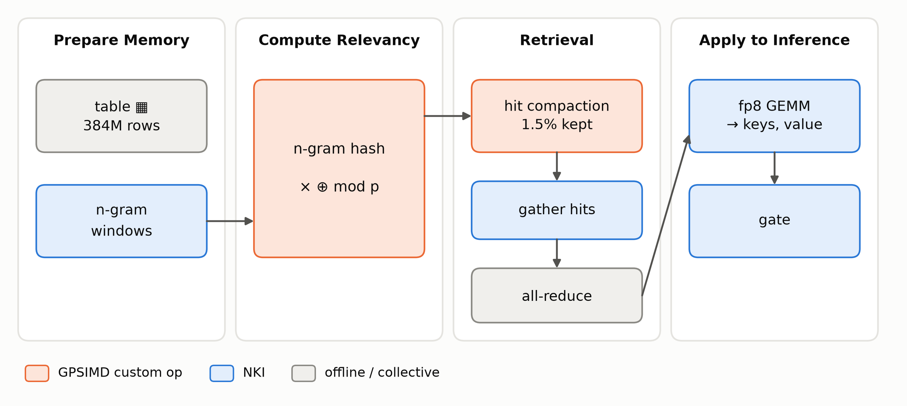
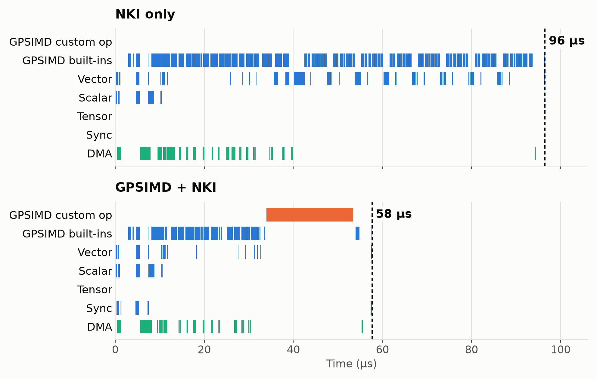
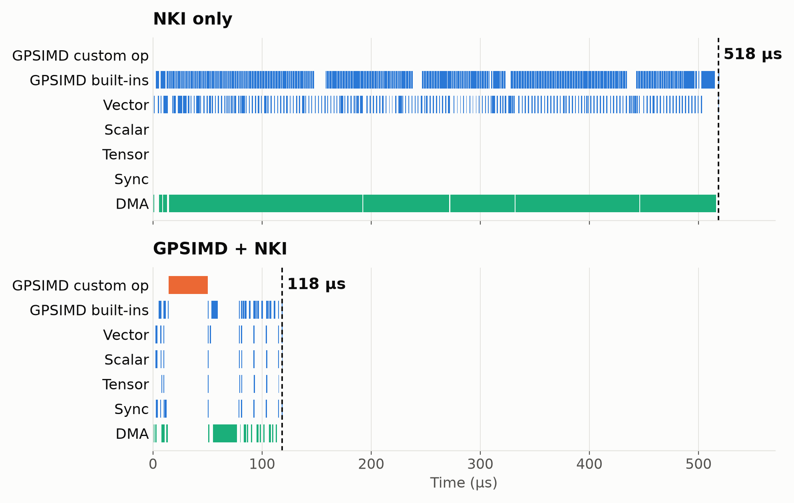
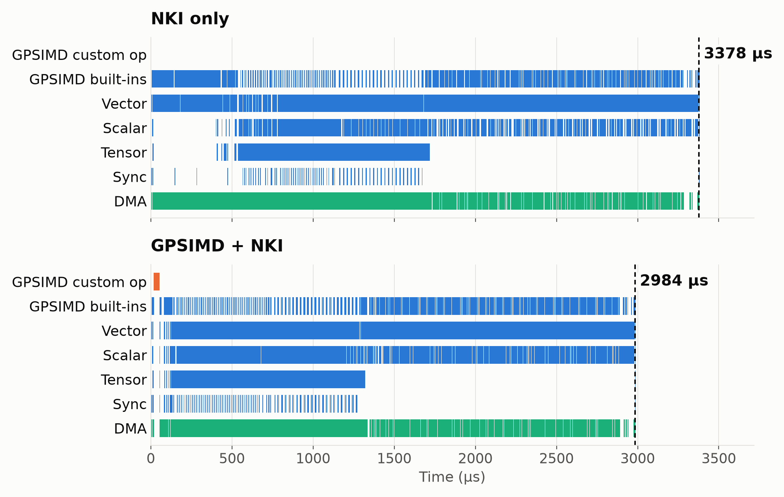
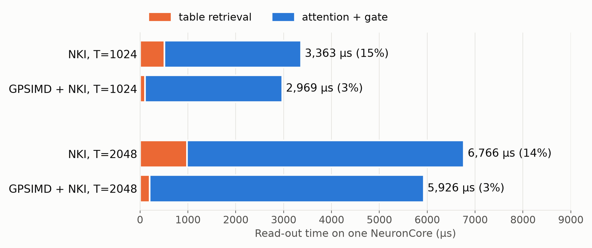

## Exploit the Native Hardware Heterogeneity: Custom GPSIMD Operator for Accelerating Emerging LLM Memory on AWS Trainium

> Disclaimer: Every Trainium conclusion and experiment in this blog comes from the Neuron SDK 2.33 toolchain, run and measured on a single trn3.48xlarge instance. We installed the Neuron GPSIMD Toolchain v1.25, which is a legacy version used for trn1 instances. We then built the toolchain by reverse engineering how the Neuron runtime loads and runs GPSIMD code, so treat all of the information as reference only. The information does not necessarily reflect how AWS implements things internally.

#### High-level Summary

- **Emerging LLM memory modules, such as Engram in DeepSeek-V4.1-Flash, have heterogeneous computation characteristics.** Engram finds a token's embedding memory with a 64-bit n-gram hash and a sparse table lookup, which are irregular bitwise integer operations and table lookups with irregular, non-consecutive data access. It then uses the memory with a dense GEMM for attention and a gate, which are dense regular computations. A GPU-FPGA prototype that moves the irregular steps to FPGAs and fuse with part of the attention, accelerating Engram by 5.9x on small batches, indicating that such disaggregation on heterogeneous platforms is promising.
- **Trainium's native heterogeneity allows a finer split than a GPU-FPGA system.** Each Trainium 3 NeuronCore pairs dense engines with a GPSIMD Engine, which is an 8-core SIMD processor. All engines share the on-chip SBUF with nanosecond level access latency and allows concurrent data access between engines, reducing the communication overhead. Unlike the FPGA in our prototype, which has abundant computational resources, the GPSIMD cores are slow at highly parallel arithmetic. We therefore deploy the n-gram hashing and table retrieval in Engram on GPSIMD and the rest on the other engines (Tensor, Vector, and Scalar Engines).
- **We can integrate GPSIMD custom operators into NKI kernels, even without public support.** NKI itself reaches the GPSIMD cores only through fixed built-in instructions, such as topk and iota. With our toolchain derived from the legacy GPSIMD toolchain for Trainium 1, the NKI kernel marks each call site with `gp.call`, and the toolchain compiles the C++ operator for the GPSIMD cores on Trainium 3. The toolchain then injects the operator into the compiled NEFF as one `KERNEL_CALL` instruction. The operator reads and writes the same SBUF tiles as the surrounding NKI code.
- **Two GPSIMD operators speed up Engram in DeepSeek-V4.1-Flash by up to 1.14x.** We compare against a hand-optimized NKI port of DeepSeek-V4.1-Flash. The n-gram hashing becomes 1.79x faster at decode, and the table retrieval becomes up to 4.9x faster. The whole Engram is 1.14x faster in prefill with 2048 tokens and 1.05x faster at decode.


*Figure 1. Speedup over the baseline without GPSIMD custom op (the hand-optimized NKI port), on one NeuronCore. Decode runs 10 sequences. Whole Engram counts both Engram layers.*

#### Table of Contents

- [Introduction](#introduction)
  - [Heterogeneity of Computation Properties in LLMs](#heterogeneity-of-computation-properties-in-llms)
  - [Example: Engram in DeepSeek-V4.1-Flash, and How We Accelerate It on a GPU-FPGA System](#example-engram-in-deepseek-v41-flash-and-how-we-accelerate-it-on-a-gpu-fpga-system)
  - [Native Hardware Heterogeneity of Trainium](#native-hardware-heterogeneity-of-trainium)
- [Build and Use GPSIMD Custom Operators for Kernel Optimization](#build-and-use-gpsimd-custom-operators-for-kernel-optimization)
  - [Overall Development and Deployment Flow](#overall-development-and-deployment-flow)
  - [Write Operators in C++](#write-operators-in-c)
  - [Integrate the Custom Operator with NKI](#integrate-the-custom-operator-with-nki)
  - [Runtime: What Happens Under the Hood](#runtime-what-happens-under-the-hood)
- [Accelerating Engram in DeepSeek-V4.1-Flash with the GPSIMD Engine](#accelerating-engram-in-deepseek-v41-flash-with-the-gpsimd-engine)
  - [n-gram Hashing (86.95 µs to 48.45 µs, 1.79x)](#n-gram-hashing-8695-µs-to-4845-µs-179x)
  - [Table Retrieval (506.9 µs to 102.4 µs, 4.95x)](#table-retrieval-5069-µs-to-1024-µs-495x)
  - [Results and Analysis](#results-and-analysis)
- [What Other Operations Can GPSIMD Help With?](#what-other-operations-can-gpsimd-help-with)
- [Limitations](#limitations)
- [Acknowledgement](#acknowledgement)

---

### Introduction

#### Heterogeneity of Computation Properties in LLMs

Modern LLMs depend on complex mechanisms to manage their memory: sparse attention selects key-value entries, retrieval-augmented generation (RAG) selects documents, and compressed memories select memory slots. Prior works published in ICML 2026 [1] showed that these mechanisms share a **memory processing pipeline** of four steps (Figure 2):

1. **Prepare Memory**: turn the memory into a form that is easy to search and use (for example, indexing vectors).
2. **Compute Relevancy**: score or identify the memory entries that matter for the current input.
3. **Retrieval**: select and fetch the relevant subset.
4. **Apply to Inference**: feed the retrieved memory into the rest of the model.

The key is that these steps have very different computational characteristics. Some steps are dense and regular computations, whereas others are irregular and data dependent. Therefore, a natural approach of acceleration is **fine-grain disaggregated** inference on **heterogeneous platforms**. [1] applies a GPU-FPGA heterogeneous system [2]: the dense steps stayed on the GPU and the irregular steps moved to the FPGA, for up to 2.2x faster inference and up to 4.7x lower energy. Such methodology is also transferable to more recent LLMs.


*Figure 2. The four-step memory processing pipeline in LLMs, from [1].*

#### Example: Engram in DeepSeek-V4.1-Flash, and How We Accelerate It on a GPU-FPGA System

DeepSeek-V4.1-Flash [3] is the recent 40-layer mixture-of-experts (MoE) reasoning model from DeepSeek. It combines sparse attention with MoE layers of 384 routed experts, 6 of which serve each token. Layers 1 and 14 also have an **Engram** module [4] that gives the model a large n-gram memory. For each token, Engram hashes the token and its preceding tokens into row ids, reads these rows from a large learned table, and adds a gated projection of the rows to the hidden state. Engram maps to the memory processing pipeline as follows:

- **Prepare Memory.** The table is trained offline. In DeepSeek-V4.1-Flash, each Engram layer has 384M rows of 256 bf16 values. At run time, each token's n-gram window is collected: the token's compressed id and the ids of the 3 preceding tokens.
- **Compute Relevancy.** An n-gram hash turns each window into row ids. For n = 2, 3, 4, the hash multiplies each token id by a 64-bit constant, combines the products with XOR, and reduces the result modulo one of 8 primes of about 16M. Each token gets 3 × 8 = 24 row ids per layer.
- **Retrieval.** The 24 rows of each token are read into an embedding `emb` of shape [T, 24 × 256].
- **Apply to Inference.** A GEMM projects `emb` to 4 keys and 1 value of 5120 values each. A gate adds the value to each of the 4 residual streams, scaled by the dot product of the stream's hidden state and its key.

We also tried to deploy Engram on our GPU-FPGA heterogeneous system to demonstrate the effectiveness of such abstraction [2]. Here we use the original demo of Engram in [5]:

- **FPGA: Compute Relevancy, Retrieval, and the key and value projections.** A hash unit computes the 16 row ids of one token per cycle. 16 lookup units read the rows from separate HBM channels. 8 projection units keep the weights in on-chip memory.
- **GPU: the gate, a short convolution, and the residual add.** These steps need the hidden state from the previous layer.


*Figure 3. The GPU-FPGA split of Engram in HeteroLLM [2]. h is the hidden state.*

The baseline is the reference code [5] on the GPU, which computes the hash on the host CPU. With 2 AMD U55C FPGAs and 1 AMD MI210 GPU, Engram is 5.2x faster at 8 tokens, 5.9x faster at 32 tokens and 1.15x faster at 1024 tokens. The gain is largest at few tokens, as in decode. There, most of the baseline time is a fixed cost per call: the hash on the host, the copy of the ids, and many small GPU operators. At 8 tokens, the baseline spends 0.98 ms on the hash alone, while the FPGA takes 0.39 ms for the hash, the lookup and the projections together. 


*Figure 4. Engram on the GPU alone and on the GPU with 2 FPGA boards. Engram reference configuration [5].*

The prototype shows that Engram gains from moving its irregular steps to flexible hardware. This technique is transferable to AWS Trainium devices: Trainium NeuronCore is natively heterogeneous.

#### Native Hardware Heterogeneity of Trainium

In this work, we conduct all the experiments on a Trainium 3 instance. A trn3.48xlarge instance exposes 64 NeuronCores (each made of 2 physical cores). A Trainium 3 NeuronCore is a heterogeneous processor (Figure 5). The **Tensor Engine** is a 128x128 systolic array for matrix multiplication. The **Vector Engine** and the **Scalar Engine** apply element-wise operations, reductions and activation functions to tiles of up to 128 partitions. The **Sync Engine** issues queued DMA transfers. All engines read and write the on-chip **SBUF** (state buffer), and the Tensor Engine accumulates into **PSUM**.

The fifth engine, the **GPSIMD Engine**, is different from the other four. The GPSIMD Engine is a group of 8 general-purpose SIMD cores. Each core has its own local data RAM, an integrated DMA channel (iDMA), and a compute unit that support 64-bit wide arithmetics. The cores run firmware that implements the GPSIMD Engine's instructions in software.


*Figure 5. Trainium 3 device diagram and the architecture of a NeuronCore, from the Neuron SDK documentation [6].*

Each engine fits a different kind of computation, so each step of Engram has a natural place:

| Engine | Specialized Computations | Which Computation in Engram? |
|---|---|---|
| Tensor Engine | dense matrix multiplication | the dense GEMM that projects the retrieved embeddings to the keys and the value |
| Vector and Scalar Engines | element-wise floating-point math, reductions, activations | the gating network |
| DMA/Sync engines | bulk copies between HBM and SBUF | reading the table rows |
| GPSIMD engine | integer math, per-element branches, variable-length output | the n-gram hashing, and finding which lookups of the table retrieval hit this rank's table shard |

The n-gram hashing and the table retrieval go to the GPSIMD cores because both are irregular integer work. The hash needs 64-bit products and a 64-bit modulo: the cores compute the products, while the other engines compute exact integer arithmetic only on 32-bit values. In the table retrieval, only about 1.5% of a token's lookups hit the table shard of a rank. GPSIMD engine can drive the table lookups on these entries in the table to issue DMA. The dense GEMM and the gate stay on the Tensor, Vector and Scalar Engines, as GPSIMD engine has much lower peak performance in dense linear algebra than other engines. In general, a step suits the GPSIMD cores when it is integer-heavy, data-dependent, and small in data compared with the dense work around it.

Although this is a promising plan, a major blocker for most developer on Trainium is that there is no official support to connect custom GPSIMD operations with the kernel language in Trainium to optimize the whole kernel. In the next section, we will illustrate how to integrate custom GPSIMD operator with Neuron Kernel Interface (NKI) for a coherent optimization.

---

### Build and Use GPSIMD Custom Operators for Kernel Optimization

The **Neuron Kernel Interface (NKI)** is the Python kernel language for Trainium [6]. Currently, NKI exposes the GPSIMD Engine only through built-in instructions on Trainium 3: tensor operations with `engine=gpsimd`, `iota`, `topk`, and the descriptor generation of indirect DMAs ("software DGE"). In the legacy SDK, there used to be a GPSIMD toolchain to create custom operator and integrate into `torch_xla` compiled kernel. However, this means if the user applied GPSIMD custom operator, the kernel can no longer be optimized with NKI. Furthermore, this package is deprecated on Trainium 3: when using the C++ custom-operator path (`AwsNeuronCustomOp`) that works on Trainium 1, the compiler rejects that path for Trainium 3 targets (error `NCC_EVRF030`). To make the whole stack works for Trainium, we reverse engineered and build a custom toolchain to inject the GPSIMD operator in Neuron Executable File Format (NEFF).

#### Overall Development and Deployment Flow

The Neuron compiler turns an NKI kernel into a NEFF, which holds one instruction stream per engine [8]. Our toolchain does not change the compiler. The NKI kernel is compiled as usual, and the toolchain then edits the compiled NEFF to place each custom operator in the GPSIMD Engine's instruction stream. The rest of the NEFF, including the compiler's schedule of the other engines, stays as the compiler produced it. Figure 6 shows the flow in five steps:

1. **Write** the operator in C++.
2. **Mark** the call site in the NKI kernel with `gp.call(...)`, and compile the kernel with the NKI compiler as usual.
3. **Build** the operator library: the toolchain reads the SBUF location of each tile from the compiled NEFF and compiles the C++ operator for the GPSIMD cores.
4. **Inject** the library into the NEFF, and replace the marked instructions with one `KERNEL_CALL` instruction.
5. **Load and run** the NEFF with the Neuron runtime.


*Figure 6. Development and deployment flow; the numbers are the steps listed above. Blue: NKI kernel and NEFF. Orange: the GPSIMD operator. The compiled NEFF is edited, not regenerated.*

`gpsimd-build` runs all five steps for an example directory, and `gp.compile` runs them from Python. The rest of this section follows the steps in order: step 1 in [Write Operators in C++](#write-operators-in-c), steps 2 to 4 in [Integrate the Custom Operator with NKI](#integrate-the-custom-operator-with-nki), and step 5 in [Runtime: What Happens Under the Hood](#runtime-what-happens-under-the-hood).

#### Write Operators in C++

A GPSIMD operator is a C++ function that runs on all 8 cores at the same time. As in a CUDA kernel, every core runs the same code and takes its share of the work by its core index. The runtime library gives each core typed views of the SBUF tiles passed by `gp.call`, its share of the partitions, and asynchronous iDMA copies between SBUF, HBM and the core's local RAM. The example below adds two int32 tiles:

```cpp
#include <gpsimd/gpsimd.hpp>
GPSIMD_OP(vadd_i32) {                         // extern "C" void vadd_i32(gp_call *), runs on all 8 cores
    gp::Call c(call);
    auto a = c.in<int32_t>(0), b = c.in<int32_t>(1);      // SBUF tiles passed by gp.call
    auto o = c.out<int32_t>(0);
    const uint32_t n = o.elems();
    int32_t la[4096], lb[4096];                           // staging buffers in local data RAM
    for (gp::Range blk : c.blocks(o.partitions(), 4096 / n)) {   // this core's partitions
        c.fetch(a, blk.lo, blk.size(), la);                       // iDMA SBUF -> local RAM
        c.dma_wait(c.fetch(b, blk.lo, blk.size(), lb));
        for (uint32_t k = 0; k < blk.size() * n; ++k) la[k] += lb[k];
        c.dma_wait(c.flush(o, blk.lo, blk.size(), la));           // iDMA local RAM -> SBUF
    }
}
```

Each core copies its partitions into local RAM with the iDMA, computes there, and copies the result back. This staging matters: a load from local RAM takes 12 cycles, while a direct load from SBUF takes about 296 cycles (see the cost table in [Runtime: What Happens Under the Hood](#runtime-what-happens-under-the-hood)).

The runtime also provides math functions, and a barrier, all-reduce, exclusive scan and a software lock for cooperation across cores. The cores cannot run hardware floating-point instructions, vector (FLIX) instructions or exclusive-access atomics: each of them hangs the core. The compiler wrapper rejects such code, and the runtime provides IEEE float32 in software instead (`gp::f32`, bit-identical to numpy).

Next, we show how an NKI kernel calls this function.

#### Integrate the Custom Operator with NKI

**Mark the call site.** In the NKI kernel, `gp.call` takes the operator name and the SBUF tiles that the operator reads and writes:

```python
import gpsimd_nki as gp

@nki.jit
def kernel(a, b):
    out = nl.ndarray((128, 512), dtype=nl.int32, buffer=nl.shared_hbm)
    ta, tb, tc = (nl.ndarray((128, 512), dtype=nl.int32, buffer=nl.sbuf) for _ in range(3))
    nisa.dma_copy(dst=ta, src=a); nisa.dma_copy(dst=tb, src=b)
    gp.call("vadd_i32", ins=[ta, tb], outs=[tc])        # runs on the 8 GPSIMD cores
    nisa.dma_copy(dst=out, src=tc)
    return out
```

Because the NKI compiler does not know custom operators, `gp.call` cannot emit the call itself. Instead, it emits **marker instructions**: ordinary GPSIMD Engine instructions (`TENSOR_SCALAR_ARITH_OP` and `MEMSET`) whose immediate operand carries a tag (`2^20 + 4096·site + 512·role + 32·argument + chunk`). The tag tells the toolchain which call site, role and tile a marker belongs to. The markers are placeholders that make the compiler prepare what the real operator needs:

| Marker | What it does | What the compiler then does for the operator |
|---|---|---|
| touch | updates each input tile in place | allocates the input tiles in SBUF and keeps them alive until the call |
| join | fully writes each output tile | allocates the output tiles |
| chain | links the markers through a small token tile | orders every producer of an input before the call and every consumer of an output after it |
| fill | writes a scratch tile | reserves SBUF scratch for cooperation across cores |

The markers touch whole tiles, because the compiler tracks dependencies per element range and deletes the producers of any tile region that nobody reads.

**Build the operator library.** `gpsimd-neff analyze` reads the compiled `kernel.neff` and finds the tagged markers in the GPSIMD Engine's instruction stream (`Pool0.bin`). The marker operands give the SBUF location of every tile: the first partition, the number of partitions, the byte offset inside a partition, the data type, and the free-axis access pattern. The result is `sites_resolved.json`. `gpsimd-cc` then compiles the operator with the Xtensa compiler shipped in the Neuron SDK (`xt-clang`, base instruction set only) and links three parts into the library `ops.so`:

| Part | Content |
|---|---|
| Call-site table | the tile locations of every call site, generated from `sites_resolved.json`, and one entry function `<operator>__s<site>` per call site |
| Runtime (`rt.c`) | dispatch on all 8 cores, the iDMA driver, barrier and reductions, a log ring, and a per-core receipt |
| Firmware layout | code at `0x01000000`, data at `0x02000000`, a GNU build-id, and one ELF note (owner `Neuron`, type 2) per entry function |

The tile addresses are compiled into the library, because we did not find a way for the operator to read the `KERNEL_CALL` operands at run time. Code must fit in 64 KB and static data in about 7 KB, so large buffers live on the stack (up to 64 KB in our examples).

`gpsimd-neff inject` then does the part that the compiler would do if it supported custom operators. A NEFF is a 1024-byte header plus a tar archive with one instruction stream per engine [8]. Injection adds two files and one key to the archive:

```text
final.neff
└── sg00/
    ├── Pool0.json               + "gpsimd_kernels_def": "gpsimd_kernels_def.json"
    ├── gpsimd_kernels_def.json  + [{"name": "ngram_hash__s0", "lib": "/sg00/ops.so"}]
    ├── ops.so                   + the operator library (Xtensa ELF)
    └── Pool0.bin                   markers replaced by one KERNEL_CALL per call site
```

In `Pool0.bin`, the markers of each call site become one `KERNEL_CALL` (opcode `0x85`) at the position of the site's first output marker. Byte 12 of the `KERNEL_CALL` is the index of the operator in `gpsimd_kernels_def.json`. The other markers become `EVENT_SEMAPHORE` instructions that keep the markers' waits, and the fill marker becomes a real `MEMSET` that clears the scratch tile. The bytes below come from the n-gram hashing kernel of the case study:

```text
// Pool0.bin of kernel.neff (before), bytes 0-11
slot 67:  43 10 00 00 05 03 13 03 1c 00 00 00   TENSOR_SCALAR_ARITH_OP  wait S[3] >= 28; then S[3] += 1   (join marker)
slot 68:  d4 10 00 00 05 03 00 00 1d 00 00 00   PSEUDO_DMA_DIRECT2D     wait S[3] >= 29                    (reads the output)

// Pool0.bin of final.neff (after)
slot 68:  85 10 00 00 00 00 15 03 09 00 00 00   KERNEL_CALL             operator 0; then S[3] += 9 (SEM_ADD_IMM_COMPLETE)
slot 69:  d4 10 00 00 05 03 00 00 1e 00 00 00   PSEUDO_DMA_DIRECT2D     wait S[3] >= 30
```

The hard part of injection is keeping the synchronization correct. Engines synchronize only through semaphores [8]: GPSIMD Engine instructions report completion by adding 1 to semaphore S[3], and a consumer waits until S[3] reaches a count. The 9 markers of this call site each added 1 to S[3], so the `KERNEL_CALL` adds 9 when the operator finishes, and every count that the program waits for stays reachable. This is the same idea as replacing a DMA with an `EVENT_SEMAPHORE` in [8]. The new `MEMSET` adds one more increment, so the injector raises every later wait on S[3], in all five engine programs, by one (29 becomes 30 above). Before injection, a wait for a later GPSIMD Engine instruction also implied that the markers had finished. After the renumbering, every wait covers the same instruction as before and also the `KERNEL_CALL` of every earlier call site.

The injector also supports NKI's dynamic control flow (`nl.fori_loop` with a trip count loaded into a register at run time), which the table retrieval needs. The compiler splits such a program into blocks. At each block boundary, every engine drains, synchronizes and resets its semaphores (`EVENT_SEMAPHORE_RANGE_CLEAR`, opcode `0xB0`). The injector therefore renumbers waits only up to the first reset of each engine, requires every `gp.call` to come before the first dynamic loop, and relocates the absolute target of the jump instruction (opcode `0xDD`) after it inserts slots.

#### Runtime: What Happens Under the Hood

When the Neuron runtime loads the NEFF, it reads `gpsimd_kernels_def`, and the firmware copies `ops.so` from HBM into the local RAM of all 8 cores with the iDMA. At each `KERNEL_CALL`, the firmware calls the operator's entry function on all 8 cores, with the core index as an argument.

The cores reach SBUF and HBM through **address-translation windows**. Our runner, `gpsimd-run` (a C++ program on libnrt), programs one window over PCIe BAR0 after it loads the NEFF: SBUF partition `p` appears at core address `0xD0000000 + p × 0x40000`. Further windows map HBM tensors from `0xE0000000` (512 MB). During a call, the runtime borrows the iDMA channel from the firmware and restores the channel's descriptor pointer at the end of the call; otherwise, the firmware fails when the model stops.

After every execution, each core writes a **receipt**: its processor id, the number of calls, the call sites it ran, its cycle count and its status. The receipts prove that the operator ran on the 8 GPSIMD cores and not on the host. `gpsimd-run` also compares every output with a reference, byte for byte. The toolchain has 19 examples, all bit-exact on the device. They cover integer and float data types, cooperation across cores, SBUF views, direct HBM access and several call sites per kernel. A separate test covers dynamic control flow.

Whether a step is worth a GPSIMD operator depends mostly on two costs: the fixed cost of a call, and the cost of reaching memory from the cores. These are the costs we measured (with `toolchain/probes/bench` and the case study; 1 cycle = 0.83 ns):

| Item | Cost |
|---|---|
| `KERNEL_CALL` overhead (call, dispatch, return) | about 2.6 µs |
| local RAM load / store | 12 / 7 cycles |
| SBUF load / store through the window | about 296 / 19 cycles |
| iDMA copy SBUF -> local RAM | about 600 cycles for 4 KB; 128 cycles per KB for 16 KB |
| 32-bit integer multiply / divide | 3 / 20 cycles |
| software float32 add / multiply | 117 / 97 cycles |
| barrier over the 8 cores | about 4,600 cycles |

In short, the GPSIMD cores are fast at integer work in local RAM and slow at floating point, and every call costs about 2.6 µs. A step is therefore worth an operator only if the operator saves more than the 2.6 µs that the call costs. Next, we apply the toolchain to Engram.

---

### Accelerating Engram in DeepSeek-V4.1-Flash with the GPSIMD Engine

In this case study, we accelerate the Engram computation of the DeepSeek-V4.1-Flash port for Trainium 3 [7] with two GPSIMD operators. Figure 7 shows how one Engram layer is split between the GPSIMD cores and NKI on one NeuronCore. Compared with the GPU-FPGA split of Figure 3, the cut is finer: the GPSIMD cores take only the integer steps, which are the n-gram hashing and the hit compaction of the table retrieval. The gathers, the gate and the projection GEMM stay in NKI.


*Figure 7. The Engram computation of one layer in the four-step memory processing pipeline of [1], split between GPSIMD custom operators and NKI.*

The baseline is the hand-optimized NKI code of the port (branch `deepseek_v41_trn3`, commit `3b74533`). The port splits each Engram table by row over 64 ranks (6.0M rows, 3.1 GB per rank). Each rank reads only the rows it holds into `emb` and leaves the other rows zero, and an all-reduce over the 64 ranks then completes `emb`. For a fair comparison, each experiment copies the port's NKI helper modules without changes, runs the whole Engram computation on one NeuronCore, and changes only the part named in each section. The table shard has the deployed size (6,000,097 rows, 3.1 GB) with random values, and the row ids follow the hash distribution of the model. The collectives are not run. Latency is the median `total_exec_time` of 5 profiled executions in Neuron Explorer [6]. Every output of the GPSIMD version is checked against a numpy reference and against the NKI version: the n-gram ids equal an exact Python-integer reference, `emb` is exact, and the read-out output is bit-identical to the output of the port.

In the NKI port, two steps do work that the dense engines are not built for. The hash emulates 64-bit integer arithmetic with long chains of 32-bit and fp32 instructions, and the table retrieval fetches and masks every row, although only 1.5% of the lookups hit the rank. We replace each of the two with one GPSIMD operator.

#### n-gram Hashing (86.95 µs to 48.45 µs, 1.79x)

The port computes the n-gram ids of both Engram layers (48 ids per token) once per decode step, in its step prologue. A decode step of 10 sequences verifies 1 + 5 drafted tokens per sequence, so the hash runs on T = 60 rows.

The hash needs 64-bit products and a 64-bit modulo, but the NKI engines compute exact integer arithmetic only on 32-bit values and only in limited forms. The port therefore reads each product (token id × multiplier, as two 32-bit words) from a precomputed [99092, 16] table with an indirect DMA, and combines the words with XOR. It then reduces the 63-bit result with Horner's rule over 7-bit chunks, each step with an fp32 quotient estimate corrected by one prime. In the profile, the arithmetic part of the NKI hash is 230 instructions: 166 on the Vector Engine, 58 GPSIMD built-in instructions and 6 DMAs, mostly in one long dependent chain.

The GPSIMD version keeps the port's window gathers in NKI and replaces the arithmetic part with one operator, `ngram_hash`. Each core hashes its share of the rows in registers. `mulhi` is the `MULUH` instruction, which returns the high 32 bits of a 32-bit product, so a 64-bit product takes 3 multiplies. A Barrett reduction replaces the division by the prime:

```cpp
// (token id x multiplier) mod 2^64 as two words: MULUH and MULL, then XOR into the rolling value
rh ^= mulhi(cid, ml) + cid * mh;
rl ^= cid * ml;
// v = rh * 2^32 + rl (v < 2^63) mod p, with mu = floor(2^64 / p) from the host:
// Barrett reduction, the quotient estimate is at most 3 too small
const uint64_t mid = (uint64_t)lo * muh + (uint64_t)hi * mul + mulhi(lo, mul);
const uint32_t q = hi * muh + (uint32_t)(mid >> 32);
uint32_t r = lo - q * p;
if (r >= p) r -= p;
if (r >= p) r -= p;
if (r >= p) r -= p;
```

Figure 8 shows where the time goes. Both versions spend the first 34 µs on the same NKI window gathers. After the gathers, the NKI version runs a long chain of small instructions on the Vector Engine and the GPSIMD built-ins for 62 µs, while the GPSIMD version runs one 19.5 µs `KERNEL_CALL`. Without counting semaphore waits, the GPSIMD version issues 107 instructions instead of 324. At decode, the hash drops from 86.95 µs to 48.45 µs (1.79x).


*Figure 8. One profiled execution of the hashing at decode (10 sequences, T = 60). The window gathers (first 34 µs) are the same NKI code in both versions. The NKI arithmetic takes the next 62 µs; the GPSIMD operator takes 19.5 µs.*

The operator was not faster from the start. The first version processed one row at a time and reduced each value with Horner's rule over 8-bit chunks, with one 32-bit Barrett step per chunk (5 steps per value). At 93.8 µs, it was slower than NKI (0.93x). Processing column by column keeps the constants of each prime in registers, and skipping the padding rows of the 128-row tile brought the time to 62.2 µs. The final 64-bit Barrett reduction above needs 6 multiplies and at most 3 corrections per value, for 48.45 µs.

The gain is smaller on full prefill tiles: 531.1 µs to 449.7 µs (1.18x) at T = 1024, and 1055.6 µs to 890.6 µs (1.19x) at T = 2048. On 128-row tiles, each NKI instruction does useful work on all 128 partitions, while at decode the same chain runs on 60 rows. (The port hashes prefill chunks on the host, so the prefill numbers show what a device-side hash would cost.)

NKI has no 64-bit integer multiply, so the NKI version can only emulate it with lookup tables and fp32 estimates. On the GPSIMD cores, `MULL` and `MULUH` compute the same products exactly in registers.

#### Table Retrieval (506.9 µs to 102.4 µs, 4.95x)

Each hash column j covers its own range of about 16M global rows, and rank r holds 6.0M consecutive rows. A rank's shard therefore overlaps at most 2 of the 24 columns of a layer, and only about 0.375 of a token's 24 lookups (1.5%) hit the rank. In our prefill chunk of T = 1024 tokens, rank 21 holds 372 of the 24,576 rows.

The port's `engram_gather` cannot know in advance which ids hit, because NKI needs static shapes. The port therefore computes a mask for every id, issues one indirect DMA of 128 rows per 128-token tile and hash column (192 DMAs at T = 1024), and multiplies the result by the mask (Figure 9, left). Every index of an indirect DMA costs about 5.5 ns of descriptor generation on the GPSIMD Engine, even when the index is marked out of bounds and skipped: in a separate test, 64 gathers of 640 rows took 224 µs whether 100%, 25% or 0% of the indices were valid. The 98.5% of indices that miss therefore cost as much as the hits.


*Figure 9. The ids of 16 tokens of one Engram layer on rank 21; only hash columns 7 and 8 overlap the rank's rows. Left: the NKI port fetches every row and masks the misses. Right: a GPSIMD operator lists the hits, and NKI fetches only those rows. The totals below the grids are for T = 1024.*

The GPSIMD version lists the hits first and fetches only those rows (Figure 9, right). One operator, `engram_hits`, replaces the gather loop, and one short NKI loop fetches the hits:

```cpp
// GPSIMD: each core scans its 16 partitions (all tiles, all 24 columns) after one iDMA fetch
for (uint32_t i = 0; i < NT; ++i)
    for (uint32_t j = 0; j < NCOL; ++j) {
        const uint32_t v = (uint32_t)r[i * NCOL + j];       // shard-local row id
        if (v < ROWW) { src[n] = v; dst[n] = (i * 128u + p) * NCOL + j; ++n; }
    }
const uint32_t off = c.exscan_add(n, &total);               // place each core's list
// one iDMA per list; core 0 pads to a multiple of 128 and writes the number of 128-hit chunks
```

```python
# NKI: zero-fill emb, then one gather and one scatter of 128 rows per chunk of hits
gp.call("engram_hits", ins=[ids_sb], outs=[hits_sb, cnt_sb])
reg = nisa.register_alloc(); nisa.register_load(reg, cnt_sb)
nl.fori_loop(0, reg, chunk, step=1)     # chunk(b): load 128 (table row, emb row) pairs, gather, scatter
```

At T = 1024, the operator takes 36 µs, and NKI then needs 6 indirect DMAs (3 gathers and 3 scatters) instead of 192 gathers. The retrieval stage drops from 506.9 µs to 102.4 µs (4.95x), and from 980.5 µs to 200.7 µs (4.89x) at T = 2048. Figure 10 shows the two profiles. In the NKI version, the GPSIMD Engine is busy with descriptor generation and the Vector Engine with mask arithmetic for the whole stage. In the GPSIMD version, one 36 µs operator call and 6 DMAs replace this work.


*Figure 10. One profiled execution of the retrieval stage (T = 1024). Top: 192 indirect DMAs and their masks. Bottom: the `engram_hits` operator (orange, 36 µs), then 3 gathers and 3 scatters of hit rows.*

**Decode needs a static schedule (62.1 µs to 24.7 µs, 2.51x).** At decode (T = 60), the run-time loop costs more than it saves. At every block boundary of `nl.fori_loop`, every engine drains and synchronizes. This stopped the weight stream of the following GEMM from overlapping with the gather, and with the loop, the whole read-out was 0.98x the NKI version. A token has at most 2 hits, so a second operator, `engram_hits_t`, writes the hits directly in the layout of a fixed number of indirect DMAs (2 gathers and 2 scatters per 128-token tile), with the unused entries marked out of bounds. With this static schedule, the retrieval stage takes 24.7 µs instead of 62.1 µs (2.51x), and the read-out keeps its overlap.

NKI alone cannot do this compaction efficiently. `nonzero_with_count` compacts within one partition row, so the ids would first need a different layout, and the compacted indices would need a second indirect gather. Skipped indices cost as much as valid ones, and a run-time loop costs 2.4 µs per iteration.

#### Results and Analysis

The table below lists all results. The read-out is one Engram layer: table retrieval, fp8 GEMM and gate. Whole Engram is the n-gram hashing (one call computes the ids of both Engram layers) plus the read-out of both layers, as in Figure 1. In every row, the fp8 GEMM, the gate and all data movement stay in the port's NKI code; the two operators only compute the ids and the list of hits.

| Engram computation | Size | NKI | GPSIMD + NKI | Speedup | GPSIMD does | NKI does |
|---|---|---:|---:|---:|---|---|
| n-gram hashing | decode, 10 sequences (T = 60) | 86.95 µs | 48.45 µs | **1.79x** | 64-bit products, XOR, modulo | n-gram window gathers |
| | prefill chunk, T = 1024 | 531.1 µs | 449.7 µs | 1.18x | | |
| | prefill chunk, T = 2048 | 1055.6 µs | 890.6 µs | 1.19x | | |
| retrieval stage | decode (T = 60) | 62.1 µs | 24.7 µs | **2.51x** | hit compaction | zero-fill, gather and scatter of hits |
| | prefill chunk, T = 1024 | 506.9 µs | 102.4 µs | **4.95x** | | |
| | prefill chunk, T = 2048 | 980.5 µs | 200.7 µs | **4.89x** | | |
| whole read-out | decode (T = 60) | 697.1 µs | 681.0 µs | 1.02x | hit compaction | retrieval DMAs, fp8 GEMM, gate |
| | prefill chunk, T = 1024 | 3362.9 µs | 2968.9 µs | **1.13x** | | |
| | prefill chunk, T = 2048 | 6766.4 µs | 5926.4 µs | **1.14x** | | |
| whole Engram (hashing + 2 × read-out) | decode (T = 60) | 1481.2 µs | 1410.5 µs | **1.05x** | hashing, hit compaction | window gathers, retrieval DMAs, fp8 GEMM, gate |
| | prefill chunk, T = 1024 | 7256.9 µs | 6387.5 µs | **1.14x** | | |
| | prefill chunk, T = 2048 | 14588.4 µs | 12743.4 µs | **1.14x** | | |

Because the projection and the gate are unchanged, the speedup of the whole read-out depends on how much of the read-out the retrieval stage takes. Figure 11 shows the whole read-out at T = 1024. The GEMM on the Tensor Engine reads `emb`, so in the NKI version, most of the GEMM runs after the last gathered rows arrive at about 506 µs. In the GPSIMD version, the GEMM starts at 124 µs. The GEMM ends at 1,717 µs in the NKI version and at 1,318 µs in the GPSIMD version, about 400 µs earlier. The gate after the GEMM takes the same 1.66 ms on the Vector Engine in both versions.


*Figure 11. One profiled execution of the whole Engram read-out (T = 1024). The GPSIMD operator (orange, 36 µs) lets the GEMM start about 400 µs earlier; the rest of the read-out is unchanged.*


*Figure 12. The read-out split into the table retrieval stage (measured alone) and the rest (the total minus the retrieval stage). The percentage is the share of table retrieval.*

Figure 12 shows the effect of Amdahl's law. The retrieval stage is 14% to 15% of the NKI read-out in prefill, and GPSIMD reduces the stage to 3%. The 404 µs saved in the stage at T = 1024 become 394 µs saved in the read-out (1.13x), and the 780 µs saved at T = 2048 become 840 µs (1.14x). At decode, the read-out of 60 tokens is dominated by streaming the 157 MB fp8 weight matrix, and the gain is 697.1 µs to 681.0 µs (1.02x). With the n-gram hashing added, the whole Engram becomes 1.05x faster at decode and 1.14x faster in prefill (Figure 1).

---

### What Other Operations Can GPSIMD Help With?

Nothing in this method is specific to Engram. Any step that is integer-heavy, data-dependent and small in data compared with the dense work around it is a candidate (see [Native Hardware Heterogeneity of Trainium](#native-hardware-heterogeneity-of-trainium)). Before Engram, we used the same toolchain on kernels of the NKI Library [9]. Against the library's NKI implementations, we measured these speedups:

| Kernel | Speedup over the NKI Library |
|---|---:|
| argsort | 6.6x to 40x |
| BM25 scoring | 15x to 27x |
| scatter-add with duplicate indices | 4.45x |
| MoE dispatch metadata | 2.25x to 5x |
| MoE token permutation | 1.42x |

However, a GPSIMD operator is not always the best choice. For the expert-parallel MoE dispatch of Qwen3-235B at decode size (router, token permutation and all-to-all metadata), our GPSIMD version (39.3 µs) was 4.95x faster than the NKI Library version (194.7 µs), but a hand-optimized NKI version (37.0 µs) was faster still. In DeepSeek-V4.1-Flash, we also found no gain for three other candidates: deduplicating the key fetches of prefill sparse attention (the dedup needs data-dependent sizes, and NKI pays for skipped indices and run-time loops), MoE at decode (the time is weight streaming), and the mHC and DSpark computations (floating point). The lesson matches [1]: a disaggregated design pays off when each part goes to the hardware that suits the part. The best NKI implementation is the baseline that decides whether a GPSIMD operator is worth the call.

---

### Limitations

**Engram is a small part of end-to-end inference.** We estimated the time of the Engram computation from the port's own profile of DeepSeek-V4.1-Flash on 64 logical NeuronCores [7] (`PROFILE_REPORT_tp64_opt10.md`, rank 0). The estimate is the difference between each Engram block and a block of the same kind without Engram (`r0_e` vs `r0`, `r2_src_idx_e` vs `r2_src_idx`):

| Phase | End-to-end time | Engram (estimated) | Share |
|---|---:|---:|---:|
| decode step, 1 sequence, 1k context | 28.6 ms | 0.87 ms | 3.0% |
| decode step, 10 sequences, 1k context | 47.2 ms | 0.85 ms | 1.8% |
| decode step, 1 sequence, 8k context | 29.5 ms | 0.90 ms | 3.0% |
| decode step, 10 sequences, 8k context | 51.8 ms | 0.82 ms | 1.6% |
| prefill (TTFT), 1 request × 1024 tokens | 246.8 ms | about 6.4 ms * | about 2.6% |
| prefill (TTFT), 1 request × 8192 tokens | 1.69 s | about 46 ms * | about 2.7% |

\* In prefill, only the layer-14 block has a comparable block without Engram; the estimate counts the layer-14 difference twice.

The n-gram hashing runs in the decode step prologue, which takes 0.12 ms to 0.49 ms of a step in total (0.4% to 0.9%). With Engram at 1.6% to 3.0% of the time, the GPSIMD speedups give only a small end-to-end gain. The deployment splits each Engram computation over the 2 physical cores of a logical NeuronCore. If this halves our single-core times, the two GPSIMD operators would save about 0.05 ms of a 47.2 ms decode step (about 0.1%) and about 0.4 ms of a 246.8 ms TTFT (about 0.2%; the port hashes prefill tokens on the host, so only the retrieval gain applies). The value of the case study is the method and the stage-level gains, not the end-to-end number for this model. Models or workloads with a larger memory-processing share, such as larger Engram tables or retrieval over many documents, would gain more from the same split.

**The read-out is limited by NKI work.** After the retrieval stage moves to GPSIMD, the gate on the Vector Engine (1.66 ms) and the fp8 GEMM (1.19 ms) make up most of the read-out. Both are dense floating-point work that belongs on the NKI side.

**The GPSIMD cores are small.** The 8 cores run at 1.2 GHz without a usable floating-point unit, so a GPSIMD operator helps only with integer, control-heavy steps that touch little data. Each call costs about 2.6 µs, which rules out very small steps. The NKI consumers of a GPSIMD result still need static shapes. Variable-length results therefore need either a run-time loop (2.4 µs per iteration, and the loop breaks the overlap between engines) or a padded static schedule.

**The toolchain is not a supported product.** We built the toolchain by reverse engineering Neuron SDK 2.33, and a new SDK version may break it. The current version supports one NeuronCore per NEFF (`LNC=1`) and requires every `gp.call` to come before the first dynamic loop. The host must program the SBUF and HBM address windows after loading the NEFF. Our runner does this, but `torch-neuronx` and vLLM do not, so the operators are not yet integrated into the serving stack of the port. All measurements run one Engram computation on one NeuronCore without the collectives.

---

### Acknowledgement

This work is supported by the AWS Build on Trainium program at UCLA. We used [AutoHelix](https://github.com/awslabs/AutoHelix) as the agentic loop harness to optimize the kernel, with special modifications to add constraints based on human experts. We would like to thank Ellen Hermansen from the Amazon Research Initiative team for providing AWS access and promotional credits, Amit Kachroo for providing technical insights in the Amazon Science Hub program, and James Hamilton for the continuous support on providing latest Trainium instances. The toolchain, examples and case studies are in this repository: `toolchain/` (tools, runtime, 19 examples), `nkiopt/cases/ds41_engram` and `nkiopt/cases/ds41_ngram` (the case study), and `figs/` (figures and the profile data behind them).

References:

[1] Zifan He, Rui Ma, Yizhou Sun, Jason Cong. [Understand and Accelerate Memory Processing Pipeline for Large Language Model Inference](https://arxiv.org/abs/2603.29002). arXiv:2603.29002.

[2] [HeteroLLM](https://github.com/OswaldHe/HeteroLLM), the GPU-FPGA heterogeneous inference framework, with the Engram implementation described in the [Introduction](#example-engram-in-deepseek-v41-flash-and-how-we-accelerate-it-on-a-gpu-fpga-system) (`kernels/deepseek_engram`).

[3] DeepSeek-AI. [DeepSeek-V4.1-Flash](https://huggingface.co/deepseek-ai/DeepSeek-V4.1-Flash), model card on Hugging Face.

[4] DeepSeek-AI. [Conditional Memory via Scalable Lookup: A New Axis of Sparsity for Large Language Models](https://arxiv.org/abs/2601.07372). arXiv:2601.07372.

[5] DeepSeek-AI. [Engram reference implementation](https://github.com/deepseek-ai/Engram) (`engram_demo_v1.py`), the reference configuration and the GPU-only baseline of the GPU-FPGA experiment (run from the copy in [2], `kernels/deepseek_engram/engram_demo.py`).

[6] AWS Neuron documentation: [Trainium3](https://awsdocs-neuron.readthedocs-hosted.com/en/latest/general/arch/neuron-hardware/trainium3.html) and [Trainium3 Architecture Guide for NKI](https://awsdocs-neuron.readthedocs-hosted.com/en/latest/nki/guides/architecture/trainium3_arch.html) (the sources of Figure 5), [About NKI](https://awsdocs-neuron.readthedocs-hosted.com/en/latest/nki/get-started/about/index.html) and [Neuron Explorer](https://awsdocs-neuron.readthedocs-hosted.com/en/latest/tools/neuron-explorer/index.html), the profiler used for every measurement.

[7] [DeepSeek-V4.1-Flash port for Trainium 3 in vllm-neuron](https://github.com/OswaldHe/vllm-neuron/tree/deepseek_v41_trn3/contrib/models/deepseek_v41/src) (branch `deepseek_v41_trn3`), the hand-optimized NKI baseline and the end-to-end profile.

[8] [Accelerate Below Kernel Level: NEFF-based Performance Optimization on AWS Trainium](https://github.com/OswaldHe/neuron-neff-doc/blob/main/BLOG.md), the NEFF format that the toolchain uses to inject GPSIMD custom operators.

[9] [NKI Library](https://github.com/aws-neuron/nki-library), the NKI kernels used as baselines for the other GPSIMD operators.
